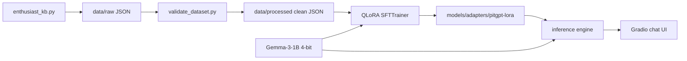

# 🏎️ PitGPT — Offline F1 Enthusiast

> A fully-local Formula 1 **enthusiast** chatbot, fine-tuned from
> [`google/gemma-3-1b-it`](https://huggingface.co/google/gemma-3-1b-it)
> with **QLoRA** — small enough to train and run on a 4 GB laptop GPU.

PitGPT chats like a lifelong F1 fan and knowledgeable friend: warm, enthusiastic,
and conversational. The fine-tune deliberately teaches **communication style and
personality**, not facts (the base model already knows F1) — so it welcomes
beginners, debates rivalries, and explains the tech without sounding like a manual.

---

## Table of contents
- [Overview](#overview) · [Motivation](#motivation) · [Features](#features)
- [Architecture](#architecture) · [Folder structure](#folder-structure)
- [Installation](#installation) · [Dataset](#dataset) · [QLoRA explained](#qlora-explained)
- [Training](#training) · [Running the app](#running-the-app) · [Screenshots](#screenshots)
- [Evaluation](#evaluation) · [Future work](#future-work) · [License](#license)

---

## Overview

PitGPT is a teaching-grade, production-structured project that takes a ~1-billion
parameter instruct model and specialises it — using parameter-efficient
fine-tuning — into a Formula 1 **enthusiast** persona. Everything runs **offline**:
data generation, 4-bit QLoRA training, evaluation, and a streaming Gradio chat UI.

- **Base model:** google/gemma-3-1b-it (gated — one-time `huggingface-cli login`)
- **Method:** QLoRA (4-bit NF4 frozen base + LoRA adapters), teaching *style not facts*
- **Trainable params:** ~13 M of ~664 M (**~2 %**)
- **Target hardware:** NVIDIA RTX 3050 Laptop, 4 GB VRAM, Windows, Python 3.11
- **4 GB tuning:** batch 1 / seq 384 / grad-checkpointing / paged 8-bit optimizer

## Motivation

Large models are impressive but inaccessible to fine-tune on consumer hardware.
This project shows the *whole* pipeline — environment, data, theory, training,
evaluation, and a UI — at a scale that fits a **4 GB laptop GPU**, while explaining
every engineering decision (see [`docs/`](docs/)). It doubles as an interview-prep
resource: each phase ships teaching notes and Q&A.

## Features

- 🧠 **QLoRA fine-tuning** that fits in ~1 GB of VRAM (peak ~0.7 GB observed).
- 🗂️ **~1000-pair instruction dataset** generated from hand-verified F1 knowledge
  (no hallucinated facts), with a JSON validator + statistics tool.
- 💬 **Streaming Gradio chat** with multi-turn history, an F1 pit-wall theme, and
  a reset button.
- 🔌 **Adapter-only artifacts** (tens of MB) with graceful fallback to the base
  model when no adapter is present.
- 🧩 **Modular `src/` package** with a single config source of truth, type hints,
  logging, and tests.
- 📚 **Phase-by-phase docs**: theory notes *and* interview questions for each phase.

## Architecture

Data flows left-to-right; the package layout mirrors the pipeline:

```
knowledge_base.py ─► data/raw ─► data/processed ─► QLoRA train ─► models/adapters
                                                                       │
                                          Gradio app ◄── inference ◄────┘
```



## Folder structure

```
PitGPT/
├── src/pitgpt/
│   ├── config/         # settings.py — single source of truth (paths, model, LoRA, training)
│   ├── data/           # knowledge_base, build_dataset, validate_dataset
│   ├── inference/      # model_loader, engine (streaming), baseline capture
│   ├── training/       # data_module, train (QLoRA SFTTrainer)
│   ├── evaluation/     # prompts (20), compare (base vs tuned), reports
│   └── app/            # model_service, theme, gradio_app
├── scripts/            # thin CLI entry points + check_gpu.py
├── tests/              # pytest suite
├── docs/               # phaseN_notes.md + interview_phaseN.md (teaching)
├── configs/  data/  models/adapters/  notebooks/
├── pyproject.toml  requirements.txt  LICENSE  .gitignore  README.md
```

## Installation

```bash
# 1. Create & activate an environment (Python 3.11)
conda create -n pitgpt python=3.11 -y
conda activate pitgpt

# 2. (GPU) install the CUDA build of torch FIRST
pip install torch --index-url https://download.pytorch.org/whl/cu121

# 3. Install dependencies + the package (editable)
pip install -r requirements.txt
pip install -e .

# 4. Verify the GPU / CUDA / bitsandbytes gate
python scripts/check_gpu.py
```

> **Windows + bitsandbytes:** modern versions (≥0.43) ship Windows wheels and 4-bit
> training works; this project was built and trained on Windows 11 with an RTX 3050.
> If bitsandbytes misbehaves, train in WSL2/Colab and run inference on Windows, or
> drop to plain LoRA (no 4-bit).

## Dataset

Authored by hand in `src/pitgpt/data/enthusiast_kb.py` — **~127 distinct
conversations** across driver comparisons, teams, race strategy, tyres, historic
races, regulations, technical concepts, beginner explanations, fun debates and
general chat. `build_dataset.py` expands them (with light phrasing variety) into
**~760 style-teaching examples** (~127 unique, ~110-word responses);
`validate_dataset.py` checks JSON/schema, removes malformed/duplicate rows, and
prints statistics.

```bash
python scripts/build_dataset.py     # build raw + validate → data/processed clean set
```

Design philosophy (per spec): we teach **communication style and personality, not
facts** — the base model already knows F1. Responses are written **fact-safe**
(broad, well-known history; no invented stats) so the model learns *how* to talk,
not fabricated trivia.

## QLoRA explained

Freeze Gemma-3-1B and store it in **4-bit NF4** (cheap memory). Add small low-rank
**LoRA** matrices (`r=16`, `alpha=32`) to the attention (`q,k,v,o_proj`) and MLP
(`gate,up,down_proj`) projections and train **only** those. Fit inside 4 GB with
batch-size tricks, **gradient checkpointing**, and a **paged 8-bit optimizer**.
Save only the ~tens-of-MB adapter. Full walkthrough (transformers, attention,
quantization, NF4, rank/alpha/dropout, gradient accumulation, target modules) in
[`docs/phase3_notes.md`](docs/phase3_notes.md).

## Training

```bash
python scripts/train.py      # QLoRA fine-tune → models/adapters/pitgpt-lora
```

Sized for 4 GB: 4-bit NF4 base, bf16 compute (Ampere-native, no grad scaler),
`max_length=384`, **batch 1 × 16 accumulation** (effective 16), 2 epochs. Gemma-1B
at higher batch/seq thrashed the paged optimizer near 4 GB, so batch 1 keeps ~1 GB
headroom. The trainer logs VRAM and trainable params, checkpoints every 25 steps,
and supports `PITGPT_RESUME=auto`. Details in [`docs/phase4_notes.md`](docs/phase4_notes.md).

## Running the app

```bash
python scripts/chat.py       # launches the Gradio UI at http://127.0.0.1:7860
```

Streaming replies, multi-turn memory, example "quick calls", and a reset button.
If the adapter is missing, the app runs on the base model and says so in the
header (graceful fallback). Architecture in [`docs/phase6_notes.md`](docs/phase6_notes.md).

## Screenshots

> _Placeholder — add a screenshot of the running Gradio app here._
>
> ```
> [ 🏎️ PitGPT — F1 Enthusiast ]
> You:   I'm new to F1, where do I start?
> PitGPT: Welcome — this is one of my favourite things to talk about! There's no
>         wrong way to jump in; pick a driver or team that hooks you and go from there…
> ```

## Evaluation

`scripts/evaluate.py` runs the base and fine-tuned models on the **same 20
prompts** (`src/pitgpt/evaluation/prompts.py`) with identical decoding and writes
a side-by-side `evaluation_report.md`. The Phase 1 baseline
(`baseline_outputs.md`) shows the untuned model's answers for reference — e.g. the
base model described an "undercut" as a *bent crankshaft*, which the fine-tune
corrects. Method, what to look for, and honest limitations in
[`docs/phase5_notes.md`](docs/phase5_notes.md).

## Future work

- Author more distinct concepts to raise output diversity beyond 44 answers.
- Add a held-out test split and an LLM-as-judge rubric for quantitative scoring.
- Multi-turn strategy dialogues (stint planning across several exchanges).
- Optional retrieval of live timing/regulation data for grounding.
- Export a merged model and/or GGUF for `llama.cpp` CPU inference.

## License

MIT (this project's code and adapters) — see [`LICENSE`](LICENSE). The base model
google/gemma-3-1b-it is licensed by Google (Gemma terms). This repo does not
redistribute the base weights.

---

*A learning-focused, production-structured portfolio project. Every phase is
documented in [`docs/`](docs/) with both teaching notes and interview questions.*
