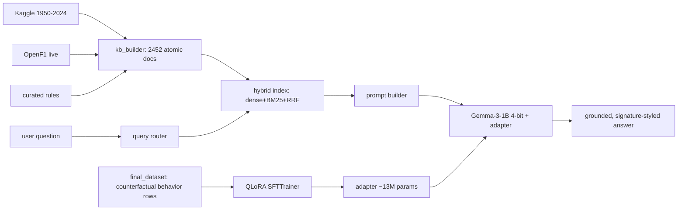
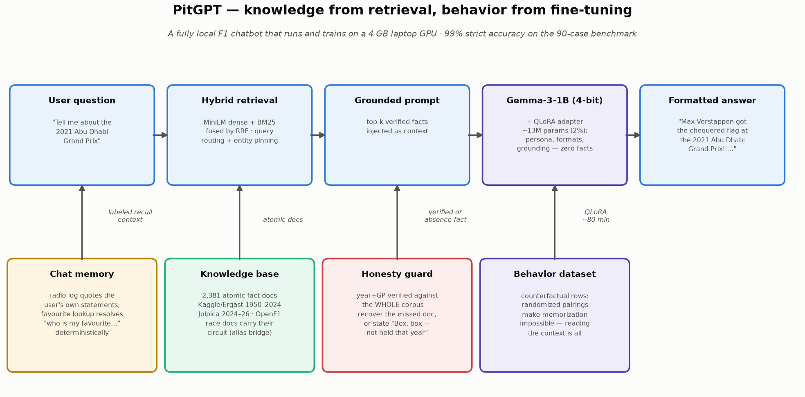
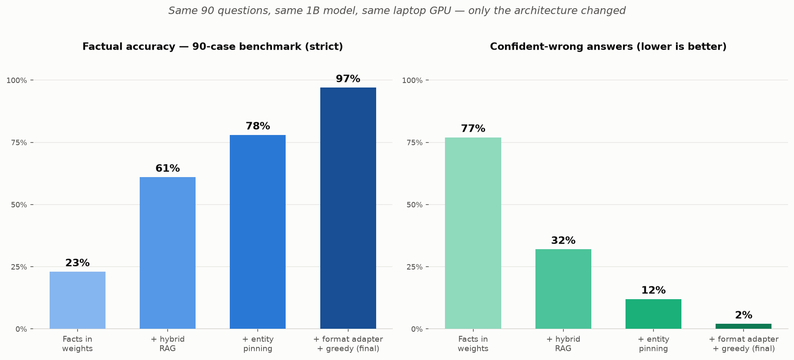
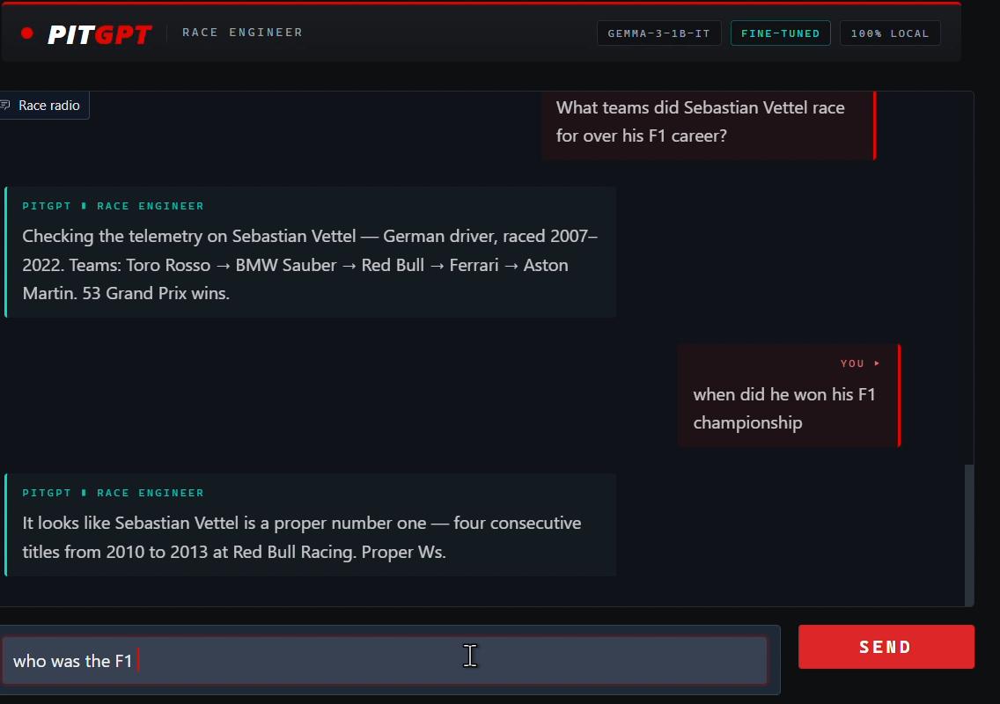

# 🏎️ PitGPT — a local F1 assistant built on one principle

> **Knowledge comes from retrieval. Behavior comes from fine-tuning.**
> A fully-local Formula 1 chatbot — Gemma-3-1B + QLoRA + hybrid RAG — that runs
> and *trains* on a 4 GB laptop GPU, with the benchmarks to justify every
> architectural decision.

PitGPT answers like an enthusiastic F1 friend, in **eight distinctive
per-category reply formats**, grounding every fact in a **2,452-document
knowledge base** covering 1950 through the current season — because we
*measured* that a 1B model storing facts in its weights tops out at **23%
accuracy**, and redesigned the system around that finding instead of
fighting it.

**The one-line story:** we tried facts-in-weights, benchmarked the failure,
moved knowledge to retrieval, retrained the adapter for *behavior only*
(persona + grounding + formats, with counterfactual data that makes
memorization impossible), then iterated retrieval precision and data realism
against the benchmark — and the same 90-case benchmark went **23% → 99%
strict accuracy, with confident-wrong answers cut from 77% → 1%**.

---

## Table of contents
- [The thesis](#the-thesis-and-the-evidence) · [Architecture](#architecture) · [Features](#features)
- [Folder structure](#folder-structure) · [Installation](#installation)
- [The training data](#the-training-data-behavior-not-facts) · [QLoRA explained](#qlora-explained)
- [Training](#training) · [Running the app](#running-the-app) · [Screenshots](#screenshots)
- [Evaluation](#evaluation) · [Future work](#future-work) · [License](#license)

---

## The thesis, and the evidence

Small language models are excellent at *behavior* and terrible at being
*databases*. This project demonstrates that split empirically, on one fixed
90-case benchmark (held-out phrasings, gold answers from the historical record):

| Architecture | Overall (strict) | Champions | Confident-wrong |
|---|---|---|---|
| Facts fine-tuned into weights (closed-book) | 23% | 30% | 77% |
| + hybrid RAG, behavior-only adapter | 61% | 93% | 32% |
| + entity pinning (context precision) | 78% | 100% | — |
| + format adapter, realistic-context training, greedy decoding | 97% | 100% | 2% |
| **+ query-routing overhaul (same adapter, no retraining)** | **99%** | **100%** | **1%** |

Same base model, same GPU, same benchmark — knowledge moved to retrieval, then
retrieval precision and training-data realism were iterated against the
measurement. Behavior-in-weights works: the eight reply formats hold at **98%**
end-to-end and entity grounding with gold context is 100%. The honest residual:
"admit when the context doesn't cover it" sits at 30% on the shipped adapter
(20-70% across training mixes, see [Evaluation](#evaluation)) — production
exposure is limited because entity pinning filters mismatched context before
the model sees it.

- **Base model:** google/gemma-3-1b-it (gated — one `huggingface-cli login` to
  download it; after that it loads from the local cache with no login or network)
- **Adapter:** ~13 M trainable params (~2%) — persona, grounding, styles; zero facts
- **Knowledge:** 2,452 atomic fact docs (Kaggle 1950-2024 + Jolpica 2024-26 +
  curated rules + OpenF1)
- **Retrieval:** MiniLM dense + BM25, reciprocal-rank fusion, query-aware routing
- **Hardware:** RTX 3050 Laptop, 4 GB VRAM, Windows — batch 1×16, seq 384,
  gradient checkpointing, paged 8-bit AdamW, bf16

## Motivation

Large models are impressive but inaccessible to fine-tune on consumer hardware.
This project shows the *whole* pipeline — environment, data, theory, training,
evaluation, and a UI — at a scale that fits a **4 GB laptop GPU**, while explaining
every engineering decision (see [`docs/`](docs/)). It doubles as an interview-prep
resource: each phase ships teaching notes and Q&A.

## Features

- 🔍 **Hybrid RAG** over 2,452 atomic fact docs: MiniLM dense + BM25 lexical,
  fused by reciprocal rank, with query-aware source routing (driver questions →
  bio docs, race questions → result docs) that fixed a measured
  popular-entity ranking failure.
- 🎨 **Eight per-category reply formats** learned in the adapter (one source
  of truth, `data/templates.py`) — *"{Winner} got the chequered flag at the
  {year} {GP}!"*, *"And that's the title! …"*, *"Checking the telemetry on
  {Driver} —"*, *"The tally board reads {N} —"*, *"Lights out and here we go
  on {circuit}!"*, *"Constructors' crown, {year}: …"*, *"Let's talk
  racecraft:"*, and the *"Box, box —"* decline — plus a warm enthusiast
  persona for opinion questions.
- 🧠 **Behavior-only QLoRA** (~13 M params) trained on counterfactually
  randomized data, so grounding on retrieved context is the only strategy the
  optimizer can learn — memorization is impossible by construction.
- 📏 **Three benchmark harnesses** (retrieval-only, grounding, factual A/B),
  resumable JSONL runs, markdown scorecards — every claim in this README has a
  number behind it.
- ✅ **Every grounded answer is checked before it is shown**
  (`inference/answers.py`): the model's reply is kept when it says what its
  fact says, and replaced by the fact's own rendering (or the decline) when it
  does not. Counts and comparisons ("most wins", "Senna or Prost") are computed
  from the records, not generated.
- 💬 **Streaming Gradio chat** with chat memory: follow-ups are resolved before
  retrieval (*"What teams did he race for?"*, *"Who won it in 2009?"*, *"And in
  2007?"*), and a deterministic "radio log" quotes back what you told it.
- 🧩 **Modular `src/` package**, single config source of truth, 166 tests,
  phase-by-phase teaching docs with interview Q&A.

## Architecture

One principle, two supply lines into the prompt:

```
                       KNOWLEDGE (retrieval)                 BEHAVIOR (weights)
  Kaggle 1950-2024 ─► kb_builder ─► 2,452 fact docs      counterfactual dataset
  OpenF1 (live grid) ──────────────► hybrid index ─┐      (signatures+grounding
  curated rules ───────────────────► (dense+BM25   │       +persona, 0 facts)
                                      +RRF+routing)│              │
                                                   ▼              ▼
   user question ─► query router ─► top-k facts ─► prompt ─► Gemma-3-1B 4-bit
                                                            + LoRA adapter (2%)
                                                                   │
                                                    grounded, in-voice answer
```



## Folder structure

```
PitGPT/
├── src/pitgpt/
│   ├── config/         # settings.py — single source of truth (paths, model, LoRA, training)
│   ├── data/           # final_dataset + templates (behavior set), persona KB, validation
│   ├── rag/            # kb_builder (corpus), index (dense+BM25), retriever (routing, pins, guard)
│   ├── inference/      # model_loader, engine (streaming, chat recall), baseline capture
│   ├── training/       # data_module, train (QLoRA SFTTrainer)
│   ├── evaluation/     # prompts (20), compare (base vs tuned), reports
│   └── app/            # model_service, theme, gradio_app
├── scripts/            # thin CLI entry points + check_gpu.py
├── tests/              # pytest suite
├── docs/               # phaseN_notes.md + interview_phaseN.md (teaching)
├── configs/  data/  models/adapters/  notebooks/
├── pyproject.toml  requirements.txt  LICENSE  .gitignore  README.md
```

## Installation

```bash
# 1. Create & activate an environment (Python 3.11)
conda create -n pitgpt python=3.11 -y
conda activate pitgpt

# 2. (GPU) install the CUDA build of torch FIRST
pip install torch --index-url https://download.pytorch.org/whl/cu121

# 3. Install dependencies + the package (editable)
pip install -r requirements.txt
pip install -e .

# 4. Verify the GPU / CUDA / bitsandbytes gate
python scripts/check_gpu.py
```

> **Windows + bitsandbytes:** modern versions (≥0.43) ship Windows wheels and 4-bit
> training works; this project was built and trained on Windows 11 with an RTX 3050.
> If bitsandbytes misbehaves, train in WSL2/Colab and run inference on Windows, or
> drop to plain LoRA (no 4-bit).

## The training data: behavior, not facts

The training set (`final_dataset.py` + `build_final.py`) teaches exactly three
behaviors — and is engineered so facts *cannot* be learned. The shipped adapter
was trained on 2,445 rows (the builder as of commit `4387f2a`); the builder at
HEAD produces 2,628, adding absence-recitation, venue-phrasing and prose-card
rows for the next adapter — the one retrain on that set regressed and was
rolled back (see [`docs/STATUS.md`](docs/STATUS.md)), so rebuilding from HEAD
does not reproduce the shipped weights.

1. **Grounding** — every factual row is **counterfactually randomized**: drivers
   paired with wrong teams, races with wrong winners, always matching the
   provided context. A model can't memorize randomized pairings, so gradient
   descent's only winning strategy is *reading the context*. (This single trick
   took context-following from 0% to 100% on entity questions.)
2. **Signature styles** — each category's reply shape, rendered *from* the
   context, never from memory.
3. **Honesty** — missing-context → say so; context about a different entity →
   don't echo the wrong fact.

Plus **127 hand-written enthusiast conversations** (`enthusiast_kb.py`) for the
opinion/chat persona. Facts live exclusively in the retrieval corpus
(`rag/kb_builder.py`), where recall is lossless.

```bash
python -m pitgpt.data.build_final    # behavior dataset → data/raw + validation
python scripts/build_rag.py          # knowledge corpus → hybrid index
```

## QLoRA explained

Freeze Gemma-3-1B and store it in **4-bit NF4** (cheap memory). Add small low-rank
**LoRA** matrices (`r=16`, `alpha=32`) to the attention (`q,k,v,o_proj`) and MLP
(`gate,up,down_proj`) projections and train **only** those. Fit inside 4 GB with
batch-size tricks, **gradient checkpointing**, and a **paged 8-bit optimizer**.
Save only the ~tens-of-MB adapter. Full walkthrough (transformers, attention,
quantization, NF4, rank/alpha/dropout, gradient accumulation, target modules) in
[`docs/phase3_notes.md`](docs/phase3_notes.md).

## Training

```bash
python scripts/train.py      # QLoRA fine-tune → models/adapters/pitgpt-lora
```

Sized for 4 GB: 4-bit NF4 base, bf16 compute (Ampere-native, no grad scaler),
`max_length=384`, **batch 1 × 16 accumulation** (effective 16), 2 epochs. Gemma-1B
at higher batch/seq thrashed the paged optimizer near 4 GB, so batch 1 keeps ~1 GB
headroom. The trainer logs VRAM and trainable params, checkpoints every 10 steps,
and supports `PITGPT_RESUME=auto`. Details in [`docs/phase4_notes.md`](docs/phase4_notes.md).

## Running the app

```bash
python scripts/chat.py       # launches the Gradio UI at http://127.0.0.1:7860
```

Streaming replies, multi-turn memory, example "quick calls", and a reset button.
The model loads on the first message, so the first reply takes ~20 s. If the
adapter is missing, the app runs on the base model and says so in the header
(graceful fallback). Once the base model is in the Hugging Face cache it is
loaded straight from disk — no login, no request to the Hub or to Gradio's
servers at start-up, and the benchmarks run with `HF_HUB_OFFLINE=1`.

Every turn is traced in the terminal and appended to `logs/chat_trace.jsonl`
(git-ignored): what was typed, which facts retrieval chose, the question put
to the model, what the model wrote, the check's verdict, and what was shown. Architecture in [`docs/phase6_notes.md`](docs/phase6_notes.md).

## Screenshots

**Architecture**



**Benchmark journey** (23% → 99% on the same 90-case benchmark)



**Chat recall: "who is my favourite driver?"** answered from the user's own statements



## The retrieval stack

**Corpus** (`rag/kb_builder.py`): 2,452 **atomic fact documents** — one
self-contained fact each (865 driver careers, 1,165 Grand Prix winners, every
Drivers' and Constructors' champion, 77 circuits, curated rules, the OpenF1
live grid, and for 2024 onward each team's line-up and — while a season is
running — the championship standings). Careers and win tallies run through the
latest season, not just to the end of the historical dump. Atomic docs
eliminate chunking entirely and keep prompt injection compact.
`python scripts/build_rag.py --refresh` re-fetches the season in progress.

**Hybrid ranking** (`rag/index.py`): MiniLM dense embeddings catch meaning;
BM25 catches exact tokens — "2016" and "2021" embed almost identically, which
is precisely how dense-only retrieval confused champion years. Both rankings
fuse via **reciprocal rank fusion** (K=60) with a relevance gate: a doc needs
lexical overlap *and* semantic support, or strong similarity on its own —
"at least one ranker" let three docs at cosine 0.09 into a DRS explainer on
token coincidences.

**Query routing** (`rag/retriever.py`): a measured failure — popular drivers
have ~90 race-winner docs that flooded ranking and buried their bio doc (the
benchmark's popularity gradient *inverted*: Schumacher scored worse than
backmarkers). Routing question types to doc families (driver → bios, "who won
the {year} GP" → race docs) fixed it: popular-tier accuracy 5% → 30%.

**Follow-up questions** (`inference/engine.py`): the adapter is trained
single-turn, so a grounded turn is answered without chat history. Whatever the
question leaves to the chat is resolved first and written into the question
itself — *"What teams did he race for?"* → *"…did Nigel Mansell race for?"*,
*"Who won it in 2009?"* → *"Who won the Singapore Grand Prix in 2009?"*,
*"And in 2007?"* → the previous question for 2007 — so retrieval and the model
both get a complete question. This came from replaying whole chats through the
model: with the benchmark at 99%, a title answer followed by *"What teams did
he race for?"* was carding the wrong driver. Generic *"they"* and *"it"* are
left alone.

**From a question to a shown answer** (added October 2026, after typing
ordinary questions into the running app instead of benchmark ones). The
shipped adapter is reliable on exactly one thing: one precise fact, asked in a
phrasing it was trained on. With the right fact in its prompt, *"Tell me about
the 2008 Singapore Grand Prix"* named Felipe Massa the winner (it was Alonso;
the adapter only ever saw *"Who won…"*). So the pipeline now arranges that
case and verifies the result, in five steps:

1. **Who is it about** (`rag/entities.py`): surnames, typos and nicknames
   become the corpus's full names — *"who is verstappen"* used to card Jos
   with Max's wins.
2. **The one fact** (`retriever._pick`): a question that names its subject
   gets that document directly — a driver's bio, a team's line-up, a race by
   Grand Prix, circuit or country, the first or last race of a season, the
   reigning champion, the standings. Hybrid search runs only for the rest.
3. **A standalone question** (`inference/dialogue.py`): the whole chat is
   replayed so *"And in 2010?"* → *"Who was on pole?"* → *"…the constructors
   that year?"* each resolve against the turn before.
4. **Ask, then check** (`inference/answers.py`): the model is asked in its
   trained phrasing; its reply is kept if it says what the fact says, cut at
   the first sentence that strays, or replaced by the fact's own rendering.
5. **Computed, not generated** (`rag/stats.py`): record counts and
   head-to-head comparisons are arithmetic over the records.

The cost is stated plainly under [Evaluation](#evaluation): the check can tell
that a reply uses only its fact's names and numbers, not that it reads well,
and some replies are now a note read back rather than the model's wording.

```bash
python scripts/build_rag.py               # rebuild corpus + hybrid index
python scripts/eval_grounding.py          # 105-case grounding benchmark
python scripts/eval_facts.py --tag cb     # 90-case factual A/B: closed-book
python scripts/eval_facts.py --tag rag --rag   #                 vs end-to-end
```

## Evaluation

**The headline A/B** — identical 90 cases (held-out phrasings, gold from the
historical tables), one flag between architectures:

| Metric | Facts-in-weights | **Final shipped system** |
|---|---|---|
| Overall (strict, word-boundary) | 23% | **99%** |
| Champions by year | 30% | **100%** |
| Driver team histories | 3% | **97%** |
| GP winners | 45% | **100%** |
| Career win counts | 20% | **100%** |
| Confident-wrong answers | 77% | **1%** |
| Reply-format adherence | — | **98%** |

The final system = hybrid RAG + entity pinning (query names a driver/year/GP →
only matching docs reach the prompt) + a format adapter trained on
*realistic-shaped* counterfactual contexts + greedy decoding + query routing
that sends each question type to its doc family. Each of those five levers was
added because a benchmark run isolated its failure mode; the per-iteration
reports (`v2*`, `v3`, `v4`, `diag_postfix`) are all committed, and the
`*_oct11` reports re-measure the shipped system end to end (facts and
retrieval with `HF_HUB_OFFLINE=1`; all 90 answers identical to the previous
run).

**With the answer check (October 2026).** The numbers above are the model's
own replies. The app now checks each grounded reply against its fact before
showing it, so there are two honest numbers for everything
(`*_oct11_pipeline`, `*_oct11_checked`, `*_oct11_model` reports):

| Benchmark | The model's reply as written | What the app shows |
|---|---|---|
| Facts, 90 cases | 99% (89/90) | **100%** |
| Grounding, 105 cases | 73%, 13.3% hallucinated | **86%, 0% hallucinated** |
| Retrieval, 90 cases | — | 100% hit, 100% clean, 1.0 docs per question |

On the facts benchmark 76 of 90 replies are shown exactly as the model wrote
them; the other 14 are the same fact in the same format, rendered by the
template because the model's version differed (a team name shortened, a
detail dropped, once a wrong name). On grounding, missing-context honesty goes
30% → 100% — the model's "he's at Ferrari" about the wrong driver is replaced
by the decline — and **synthesis goes 40% → 0%**: the check cannot vouch for a
comparison across facts, so it declines all of them, including the six the
model had right. In the app, driver-versus-driver comparisons are computed
instead; the benchmark's other comparison shapes are simply declined.

What the check cannot do: it verifies that a reply uses only its fact's names
and numbers and mostly its words, not that the reply reads well or answers
what was asked. A retelling built from a note's own vocabulary can pass and
still be garbled (measured: *"Points on the board: 25 — 1 point for tenth
place."*). And the benchmarks above were the questions being tuned for; the
behaviour on ordinary questions was established by typing about a hundred of
them into the running app, which is a replayed transcript, not a score.

Scoring uses word-boundary matching (a plain-substring scorer flagged phantom
hallucinations — the Kaggle constructor table contains a team named "RE", which
substring-matches inside "raced"). Team-name aliases ("Lotus F1" vs "Team
Lotus") still make strict scoring conservative on the RAG side.

**Grounding benchmark** (105 cases; counterfactual pairings, so a pass *proves*
context-reading), on the shipped adapter: 73% overall
(`grounding_report_oct11.md`) — entity grounding 100%, persona 100%,
descriptive 75%, but missing-context honesty at 30% and synthesis at 40%.
Three training iterations exposed a **decline/answer seesaw**: mixes
that maximize honest declines (70% in iteration 2) cost facts accuracy, and the
realistic-context mix that won facts+formats traded declines back down. The
force-fed mismatched contexts in this benchmark are largely filtered by entity
pinning in the production path, but the residual is reported as measured.
One live failure class is closed deterministically: a year+GP query with no
matching race on record ("2007 Singapore GP" — first held 2008) is verified
against the whole corpus and answered by the guard itself — *"Box, box —
there's no 2007 Singapore Grand Prix on the record: that race wasn't held in
2007…"* — instead of handing the model near-miss docs to restamp under the
asked year. The reply is templated, not generated: the shipped adapter
predates the guard and turned its one-line absence fact into a
self-contradictory decline, and the retrain that learned to recite it
regressed elsewhere and was rolled back. Every report is committed under
`src/pitgpt/evaluation/`.

**The journey, as measurements** (each pivot was driven by a number):

| Experiment | Result | Decision |
|---|---|---|
| 50 epochs on style data | output collapsed ("system system…") | early stopping, ~1-2 epochs |
| facts fine-tuned into 360M → 1B | fluent hallucination | bigger base helps style, not facts |
| persona adapter + naive RAG | retrieved facts ignored | grounding must be *trained* |
| counterfactual grounding data | context-following 0% → 100% | behavior-in-weights works |
| closed-book facts, 5,084 rows | 23% strict, 77% confident-wrong | knowledge moves to retrieval |
| hybrid RAG + routing + behavior adapter | 61% strict, 32% confident-wrong | retrieval works, precision doesn't |
| retrieval-only harness | 100% recall, 7% clean contexts | the gap is precision, not search |
| entity pinning + enriched race docs | 78% strict, zero training | clean context first, then train |
| format adapter (clean contexts) | 97% facts but formats keyed to context words | train on realistic doc shapes |
| realistic-context training + greedy | 97% strict, 2% confident-wrong, 98% formats | ship the adapter (v4) |
| query-routing overhaul, same adapter | **99% strict, 1% confident-wrong** | the shipped system |
| retrain on absence / venue / prose rows (v5) | 96%, GP names mangled on a common phrasing | rolled back; the guard states the absence itself |
| whole chats replayed through the model | follow-ups answered about the wrong driver, invisible to a single-question benchmark | resolve references into the question before retrieval |
| ordinary questions typed into the running app | benchmark at 99%, yet "Tell me about Hamilton" was improvised and an off-format race question named the wrong winner | pick the one fact, ask in the trained phrasing, check the reply before showing it |

## Future work

- **Break the decline/answer seesaw** (honest declines 30% shipped, 20-70%
  across training mixes): scale decline rows *with* realistic contexts and
  weight them relative to the answer rows; it's the one gate still under 90%.
- Synthesis/comparison answers under greedy decoding (40%) — likely needs
  chain-style comparison rows rather than more templates. Yes/no questions
  are outside the trained formats too.
- **A scored multi-turn benchmark.** Follow-up resolution is covered by unit
  tests and replayed chats, not yet by a number.
- **A benchmark of ordinary phrasing.** The answer check exists because the
  90-case benchmark only asks in trained shapes; a held-out set of free-form
  questions would turn "typed a hundred into the app" into a score.
- **Train the shapes the pipeline now works around**: race questions beyond
  "who won", standings, and comparisons — so fewer replies need replacing.
- Small talk is the weakest path. Greetings, thanks and the like get fixed
  replies (the adapter has none of its own and wrote essays at them); other
  free chat is cut to two sentences with no figures. What is left is short,
  not good: "Who is your favourite driver?" gets a one-line dodge.
- The next adapter: retrain on the HEAD dataset with real GP↔circuit pairs
  (the v5 lesson), so the model can recite the absence fact itself.
- Alias normalization in scoring and corpus (Lotus/Team Lotus/Lotus F1).
- GGUF export for CPU inference.

## License

MIT (this project's code and adapters) — see [`LICENSE`](LICENSE). The base model
google/gemma-3-1b-it is licensed by Google (Gemma terms). This repo does not
redistribute the base weights.

---

*A learning-focused, production-structured portfolio project. Every phase is
documented in [`docs/`](docs/) with both teaching notes and interview questions.*
